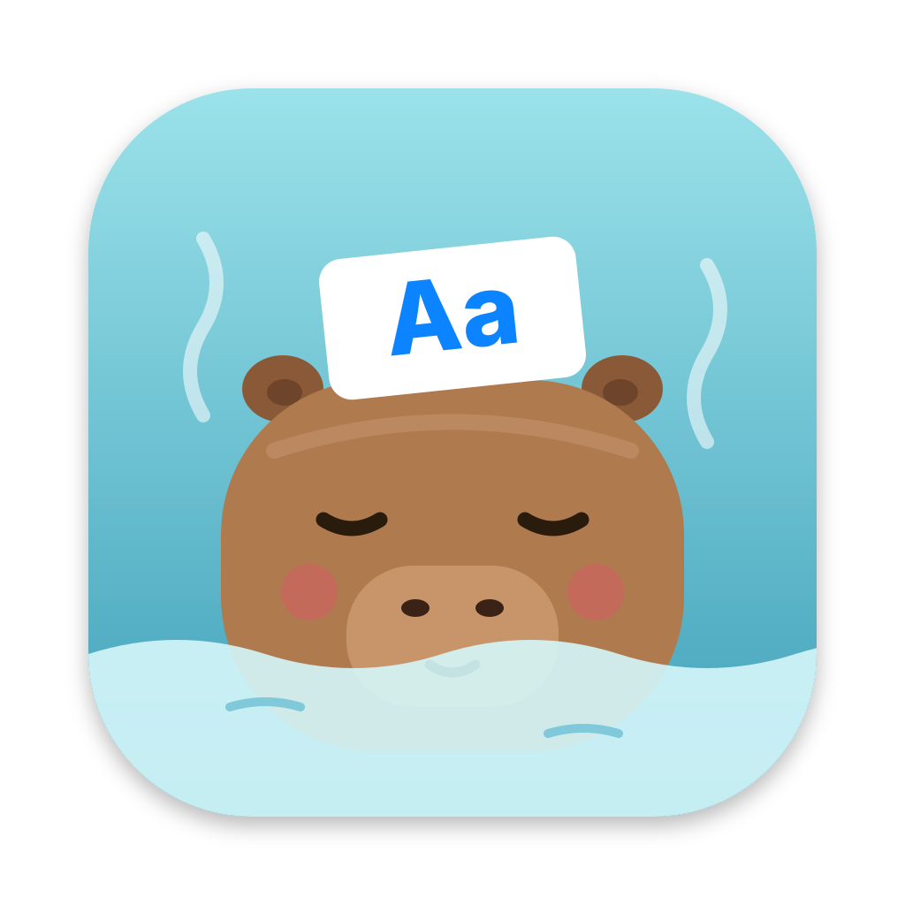

# lingvo buddy

## Build

Needs Xcode 16.3+ and XcodeGen (`brew install xcodegen`).

- `make test` runs the LingvoCore tests.
- `make app` builds the dictionary, generates the Xcode project and builds the app.
- `make run ARGS="--user-db demo --seed-demo --open card"` starts the menu-bar app.
- `make snapshots` renders the designed view states to `build/snapshots/*.png`.

QA launch arguments: `--user-db <name|path>`, `--seed-demo`, `--open card|tray|settings|about|quick-add`, `--prefill <text>` (word for `--open quick-add`), `--snapshot <dir>`, `--snapshot-filter <text>`, `--interval-seconds <n>` (card interval), `--quiet-hours <HH:MM-HH:MM|off>`.

The app's package versions are locked in `App/Package.resolved`. After a version change in `project.yml`, run `make packages` and commit the file.

## Before you push

Run `make hooks` once (needs `brew install swiftlint ruff`). Then `make check` runs on every push: tests, warning-free builds, SwiftLint, ruff and a clean tree.
