# LingvoBuddy v1 — end-to-end QA report (ticket #25)

Date: 2026-10-22. Build: `main` 1324018 plus the fixes on branch `ticket-25-e2e-qa`.
Mac: macOS 27, Xcode 27, ad-hoc signed Debug build.

## How the app was tested

- `make test` from a clean checkout: 168 core tests (26 suites), the dictionary tool tests,
  `validate.py --full` (10 000 entries), the dictionary build and `lingvo-dict check`. All pass.
- `make app` from a clean checkout: builds. One compiler warning (implicit strong capture in
  the tray) is fixed; the build now has no code warnings.
- `make snapshots`: 30 states rendered and compared with `design/screenshots/`.
- The real app ran with its own user database (`--user-db qa25`, `open -n`, only its own PID
  stopped). It was driven with real mouse clicks and key presses (CGEvent) and a few
  Accessibility actions. Timers ran with `--interval-seconds 10/25`. Logs came from
  `log show` (subsystem `com.niklod.LingvoBuddy`).

## Bugs found and fixed

| # | Bug | Fix |
|---|-----|-----|
| 1 | An untouched timed card took keyboard focus when the tray menu (or another of our panels) closed. AppKit gave key status to the card panel: the learner's next key press went into the card (key "2" answered it while TextEdit was the active app), and the card counted as "engaged", so it never auto-closed and the dot never came. Breaks stories 2 and 20. | `CardPanel` accepts key status only after a click, ⌥⌘W, a menu command or an icon click (`takeKeyFocus()`). Checked again in the real app: the same sequence leaves the key with TextEdit and the card auto-closes after 30 s; click-to-focus, ⌥⌘W and the icon reopen still give focus. |
| 2 | Long answer options were shrunk and then cut off ("подавать заявл…"). 11 card words have a main translation over 16 characters ("средства массовой информации"), so the right answer itself could be unreadable. | An option tries one line (15 pt), then one line at 13 pt, then up to 3 wrapped lines; both options of a row take the taller height. Designed states keep their exact size. New snapshot `q9_long_options`. |
| 3 | Quick add footer said "Will show in one of the next cards"; spec story 60 says "I'll show it in one of the next cards". | Label changed. |
| 4 | Compiler warning `#ImplicitStrongCapture` in `TrayMenuController`. | Capture list on the outer closure. |

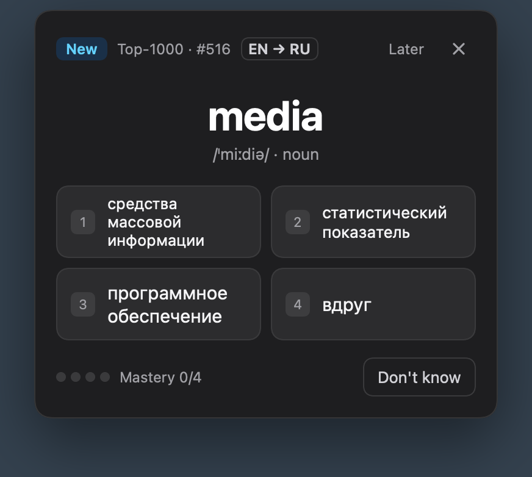

## Story groups of spec #1

| Group (stories) | Result | Evidence and notes |
|---|---|---|
| Quiz card (1–24) | **Fixed** (bug 1, bug 2) | Real app: a timed card appears under the icon and TextEdit stays the active app (2). Click on the card or ⌥⌘W gives it focus (3). Keys 1–4 answer, a second key does not change the answer, Enter = Next, Esc = skip (4, 11, 15, 19). "Don't know" shows "Answer: …", the card grows down with its top pinned (12, 14). "Later" and "×" log `later` / `skip` (17, 18). An untouched card auto-closes after 30 s, the icon gets a dot, a click on the icon reopens the card with focus (20–22). Badges, chip, rank, mastery, colours match the design (5–10, 13, 16). Animation (23) and Reduce Motion (24): code sets 150 ms fade + 6 pt slide and drops the slide under Reduce Motion; not judged by eye (see manual checks). |
| Learning rules (25–39) | **Pass** | Covered by core tests through the `Tutor` facade (mastery, 1 h gap, both directions, 7/21/60 d reviews, relapse, 20 % cap, picker order, max 10 new, distractors, Mix 70 %, Top‑2000 gate). Real app: a due learning word came before the new my word; the first card after onboarding was the easiest unknown word (#725); "word learned!" state in snapshot q5. |
| Schedule and quiet rules (40–46) | **Pass**, Focus is a **known gap** | Real app: interval stepper in Settings and the tray restarted the countdown (log `interval changed to 1200 s`). Quiet hours 13:00–15:00: log `no timed card: quietHours`, ⌥⌘W still shows a card (41). TextEdit in full screen: `no timed card: fullScreen` (43). Pause for 1 hour → tray "Paused until 14:37" + "Resume"; Resume works (44). ⌥⌘W (45). "Next in X min · every N min" (46). Focus (42): the ad-hoc build cannot carry the Focus entitlement, so Focus reads as "off" and onboarding says "Not available" (decision from #17). |
| Tray menu (47–52) | **Pass** | Real app: click on "Aa" without a dot opens the tray; streak, progress card, today line, reviews left (47–50). Inline field: typed "candle" + Enter opened quick add prefilled (51). "Open Dictionary…", "Settings…", "Quit" work (52). |
| Quick add (53–62) | **Fixed** (bug 3) | Real app: ⌥⌘L opens the panel while TextEdit stays active and key presses reach it (53). Services "Add to LingvoBuddy" (via `NSPerformService`) opened the panel with the word (54). IPA, POS and "outside Top‑1000" / "Top‑1000 · #519" (55). Pills with the first preselected (56); unknown word asks for an own translation (57). "Where I saw it" + Enter added "candle" with its example (58, 59). "Already in Learning (2/4)", "Already in My words" (62). Story 61 (queue word moves to My words) is covered by core tests. |
| Dictionary window (63–68) | **Pass**, one cosmetic **known gap** | Real app: lists with counts, table columns, search by translation ("одн"), Rules sidebar follows Settings (63–65, 67). "+ Word" opens quick add (checked by #21). Row menu: Delete with confirmation, Mark as learned, Reset progress with confirmation; Edit translation checked by #21 (68). Gap: the window buttons sit at the top of the 52 pt header, not centred (#21: macOS 26+ toolbar glass). |
| Settings (69–71) | **Pass** | Real app: General tab with interval, quiet hours, direction, reviews share, max new words, launch at login, two hotkey recorders, Data section; About tab. Launch at login (70) and changing hotkeys (71) were not toggled here: they change the owner's login items and shared defaults (see manual checks; #22 checked them). |
| Onboarding (72–75) | **Pass** | Real app with a fresh database: welcome with interval choice (10 min was saved), 30-word level check (Know by click, Don't know by the Delete key), "724 words are marked learned", step 3 with Focus ("Not available" in this build) and launch at login, "Start learning". Tray then showed 724 / 1000 learned. Skip (74) exists on the intro step and in snapshots. |
| Stats (76–78) | **Pass** | Core tests for streak, 7-day accuracy, reviews left. Real app: tray numbers changed with answers ("Today: 9 answers · 6 correct"); fresh profile shows "Streak 0 days" and "—" accuracy. |
| Data and privacy (79–82) | **Pass** | Entitlements: `app-sandbox`, `files.user-selected.read-write` only; no network entitlement and no network code (79, 82). CSV export through the sandboxed save panel wrote a valid file; import of that file: "Imported 10 words. In My words: 3."; a broken file shows the line and column of the error (80). About credits wordfreq, CC BY-SA 4.0 (81). |

## Snapshots against the design

All states were rendered with `make snapshots` and compared with `design/screenshots/` at @2x.

| Design screenshot | Snapshot | Result |
|---|---|---|
| q0–q7 (quiz card) | same names | Match: 378 pt card, layout, colours, badge colours, font sizes. Labels are English. Differences: none in layout. The RU → EN card keeps "Top‑1000 · #188" and the chip on one line (the design wraps them; that is a design-tool artifact). |
| tray_menu | `tray_menu`, `tray_menu_paused` | Match: 318 pt wide, same rows and numbers. |
| quick_add | `quick_add`, `quick_add_learning`, `quick_add_unknown` | Match: 518 pt wide. Faint vertical lines at the pill ends appear only in window snapshots, not in the real app. |
| dictionary_window | `dictionary_window`, `_search`, `_queue` | Match in layout and size (1060 × 660). Data differs on purpose: ranks come from the real bundled dictionary (although #519, not #312) and rows are sorted by last answer. Window buttons are not vertically centred (known gap above). |
| (not designed) | settings_*, onboarding_*, menubar_icon*, q8, q9 | Use the design tokens. Window snapshots render switches grey and draw a faint ghost glyph in the hotkey recorders; the real app shows the accent colour and no ghost. |

Colours in the live screenshots look a little lighter than the tokens (for example the Next button): screen captures are in the display colour profile; the snapshots, rendered in sRGB, match the tokens.

## Live screenshots

| | |
|---|---|
| 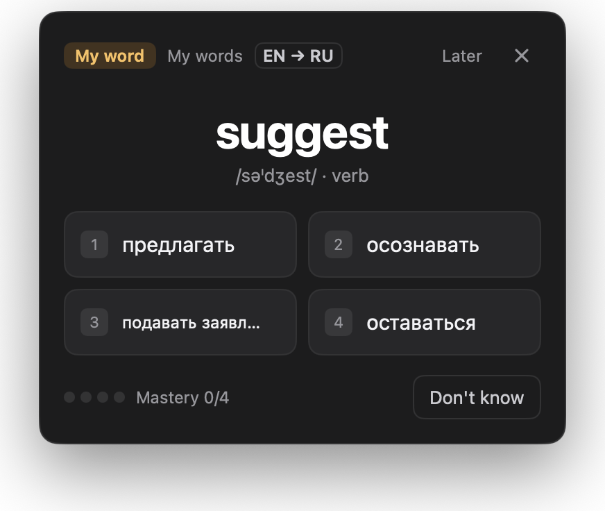 | 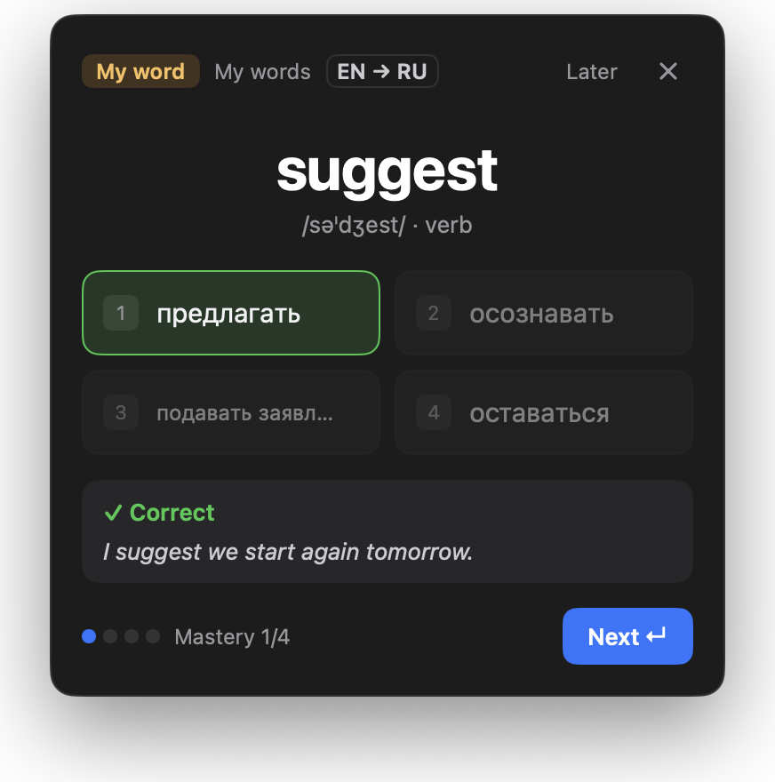 |
| 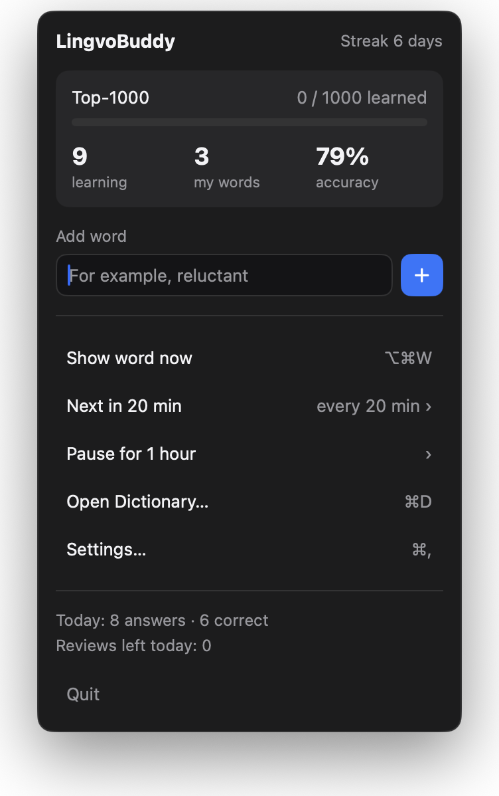 | 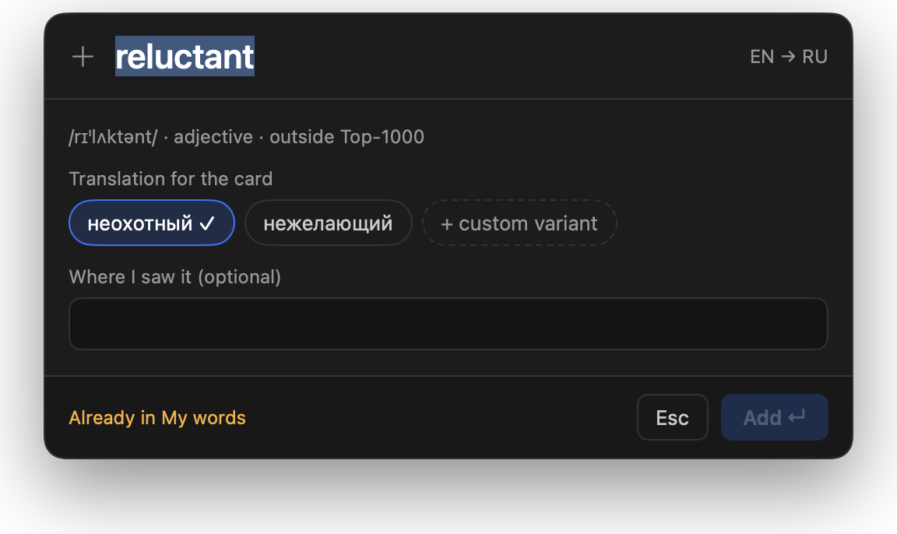 |
| 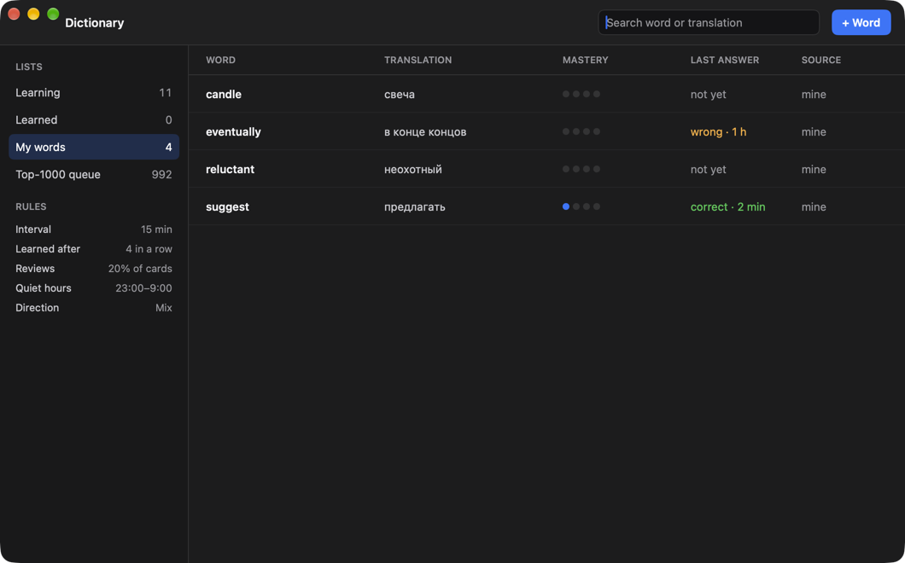 | 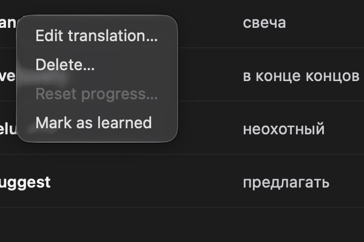 |
| 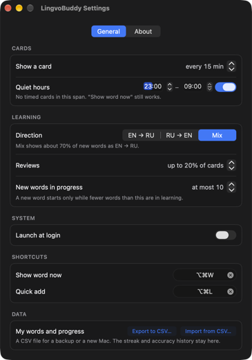 | 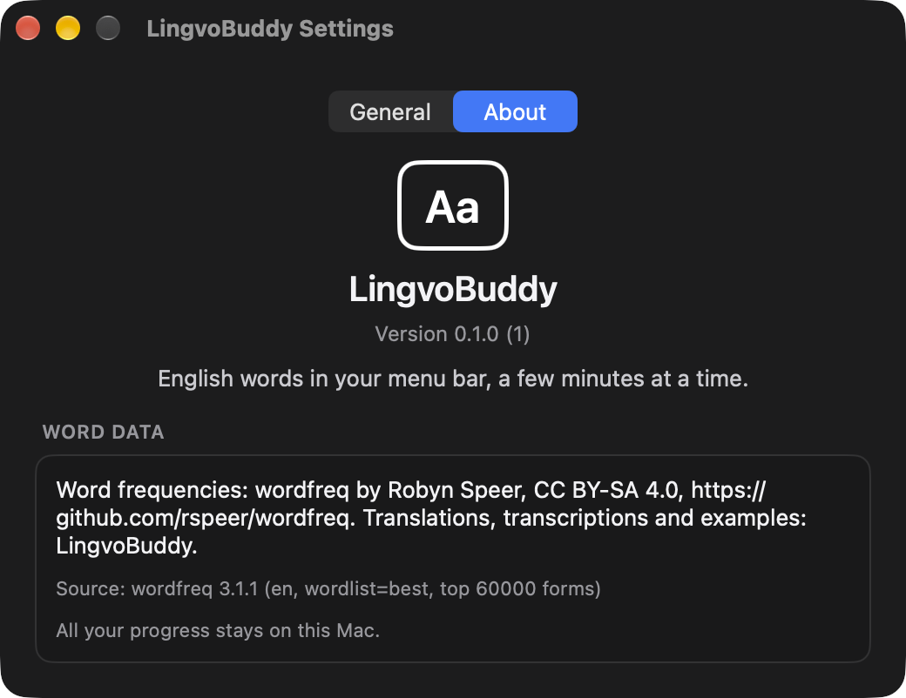 |
| 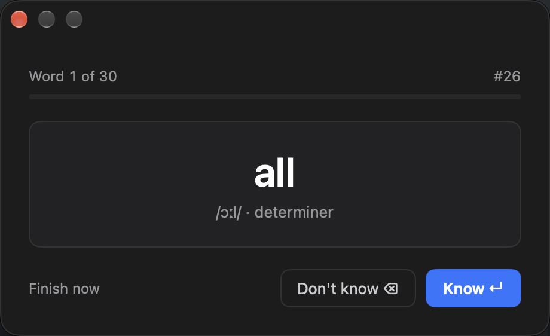 | 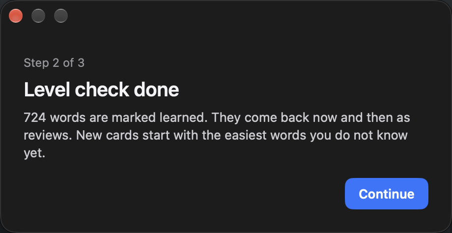 |
| 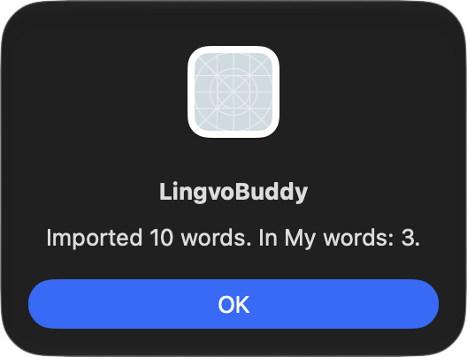 |  |

The card screenshots were taken before fix 2 (the "подавать заявл…" option is the bug).

## Known gaps (not fixed)

- Focus mode (42): needs the restricted entitlement `com.apple.developer.usernotifications.communication` and a provisioning profile. Ad-hoc builds treat Focus as off.
- No app icon: the Dock (while Settings, Dictionary or onboarding is open) and alerts show the generic icon. The repo has only the README badge; an App Store build needs a designed icon.
- Dictionary window buttons are not centred in the 52 pt header (#21).
- Settings opens with the quiet-hours start field focused; a digit typed at once edits the start time.
- The tray menu opens on top of a card that is showing (both sit under the icon).
- `--interval-seconds` is a QA-only override: Settings and the Dictionary "Rules" still show the stored interval.

## Notes for testers

- Synthetic clicks on the status item work only when the pointer enters the icon from outside: move the pointer away first.
- Unicode-string key events (`keyboardSetUnicodeString`) do not reach the quick-add panel opened by ⌥⌘L; real key codes do. Typing by a person works (#19).
- The save and open panels run out of process: drive them with Accessibility (`set value of text field "Save As:"`), not with typed keys, or keys may land in Finder.

## Manual checks for the owner

1. Card animation: fade in and 6 pt slide down in 150 ms, no sound; with System Settings → Accessibility → Display → Reduce Motion on, no slide (23, 24).
2. Launch at login: turn it on in Settings, log out and in, cards continue (70). Turn it off again.
3. Change the ⌥⌘W and ⌥⌘L hotkeys in Settings and use the new ones from another app (71).
4. Focus mode with a signed build that has the Focus entitlement (42).
5. A long card answer in the real app (for example `media`): all four options are fully readable (fix 2).
6. A day boundary: streak and "Reviews left today" after midnight; a card after the Mac wakes from sleep.
